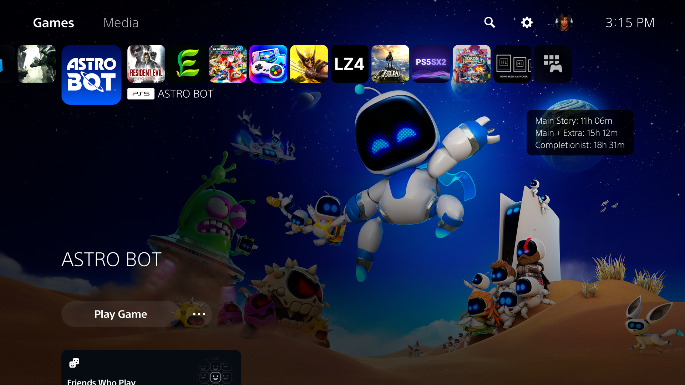

# ps5-hltb

This PS5 ELF payload adds
**HowLongToBeat Main Story, Main + Extra and Completionist times** alongside the shell's **Time played**
control. It creates a native `SceShellUI` Label in its own scene-root container,
outside React's managed view tree. One shared metrics component uses native
label typography at a fixed screen position on the right. Games with and without played time use the same appearance and layout.
The original played-time wrapper and game title are preserved.



*Captured on firmware 12.20; games without played time use the same metrics panel.*

**Firmware 12.20:** the earlier sibling-container version was visually validated
but later crashed during repeated game switching. This branch fixes native scene
ownership and bounds runtime resources; the user confirmed repeated switching no longer crashes. See
[validation and investigation](docs/PLAYTIME.md).
The earlier title-annotation version is available in release `v0.1.0`.

Queries use game titles and run directly from the console over verified HTTPS.
No PC proxy, account or API key is needed.

## Build and run

Install the [ps5-payload-dev SDK](https://github.com/ps5-payload-dev/sdk) and
LLVM. On macOS, the SDK recommends Homebrew LLVM.

```sh
export PS5_PAYLOAD_SDK="$HOME/opt/ps5-payload-sdk"
export LLVM_CONFIG=/opt/homebrew/opt/llvm/bin/llvm-config # macOS
make
make test
make deploy PS5_HOST=192.168.0.190
```

`build/hltb.elf` is the **single main payload**: it exports the installed-game
title catalog, injects the native renderer, validates and installs the native
hooks, then enables annotations. Send this ELF to elfldr with any compatible
payload sender. No additional files need to be copied onto the console.

Highlight a game. The shell's native label update identifies the selected title
and, when available, its Time played control. File-cached results display after
the background cache check; new
lookups run in the background, and a UI frame applies a completed result.

Example:

```text
Main Story: 11h 03m
Main + Extra: 14h 01m
Completionist: 31h 51m
[Time played icon] 9m
```

## Behavior and limits

- Reads installed PS5 JSON and PS4 SFO title metadata without modifying them.
- Resolves native methods and fields through Mono metadata; never reuses ASLR
  addresses from a previous session. Hook prologues must match supported
  instruction sequences or installation is rejected.
- Queries HowLongToBeat's website search, matches the game title, and reads
  `comp_main`, `comp_plus` and `comp_100` in seconds. Trademarks are removed from search terms and ignored
  when matching. Edition names and numerals remain significant.
- Missing matches and missing/zero Main Story estimates leave the shell alone.
  A failed title is not retried repeatedly during the same payload session.
- Uses verified TLS with an embedded GlobalSign Root R46 certificate. The
  unofficial website API can change, and strict title matching can miss
  localized names or edition differences.
- Caches successful results for 30 days under `/user/hltb/cache.json`, including
  across reboots. Valid file entries are displayed without a network lookup.
  The cache is bounded to 512 entries and 1 MiB and preserves unexpired records;
  an older `/system_tmp/hltb-cache.json` is migrated on first use. In-memory
  results share the file's expiry. Logs stay bounded in temporary storage.
  ShellUI can access this `/user` path; its sandbox does not mount `/data`.
  No saved game or application database is edited.
- Tracks one current game's UI control and coalesces pending updates. Game
  switches release the previous control and its ancestor handles on the UI
  thread. Identical control updates reuse the metrics panel. A single worker
  debounces navigation and performs at most one lookup at a time; it stays
  detached from Mono during network calls.
- Metrics appear on three lines using one native Label/Panel component for all
  games: native 24 px typography, white text, translucent black background,
  15 px corner radius, 24 px horizontal and 13 px vertical padding. Revealing
  played time reuses the existing metrics panel. Unavailable extra/completionist
  estimates display `N/A`.
  The three-line height is measured by the native renderer, and the scene keeps
  metrics visible independently of Play Game focus. The existing game title
  and played-time text are preserved.
- Firmware 12.20 is the only firmware tested. This is an experimental homebrew
  payload. The resident code lasts until ShellUI restarts or the console reboots.
  Loading a duplicate into the same ShellUI is refused.

## Releases

Download `hltb.elf` from [GitHub Releases](https://github.com/heydemoura/ps5-hltb/releases).
Each release also includes the optional `hltb-query.elf` diagnostic and
`SHA256SUMS` for both payloads.

The [Build and release workflow](.github/workflows/release.yml) runs the payload
build and host sanitizer tests on Ubuntu 24.04 using the checksum-pinned PS5
payload SDK v0.44 and LLVM 18. Pull requests and manual workflow runs validate
the build without publishing.

To cut a release, merge the changes to `main`, add optional release notes in
`docs/releases/vX.Y.Z.md`, then push an annotated version tag:

```sh
git tag -a vX.Y.Z -m "Release vX.Y.Z"
git push origin vX.Y.Z
```

After a successful build, the workflow creates and publishes the release with
both ELF assets and checksums. If no version-specific notes exist, GitHub
generates them. Publishing a release through GitHub's UI also runs the build
and attaches its assets. Rerunning the workflow replaces the assets for that
tag; it does not create another release. No personal access token is required.

## Query and development tools

`build/hltb-query.elf` is a separate stdout-only diagnostic:

```sh
python3 tools/query.py 'ASTRO BOT' --host 192.168.0.190
```

It accepts a title on stdin or as command-line arguments when started through
an elfldr URI. It reads the file cache first and performs a live lookup only
when no unexpired entry exists, then stores the result.

Additional development targets:

- `make deploy-probe`: read-only HTTP inspection service on port 9118,
  limited to 15 minutes; `/quit` stops it early. Use on the trusted test LAN.
- `make inject-probe`: Mono metadata probe, without native text patches.
- `make inject-trace` / `make remove-trace`: temporary text tracing and undo.
- `make inject-native` / `make enable-native`: staged renderer installation
  for inspection. The main `hltb.elf` performs both steps automatically.
- `make disable-native`: removes the completion labels on a subsequent UI frame.
- `make remove-native`: disables annotations, allows frame cleanup, then restores
  the original native method bytes.
- `make replace-native`: development replacement after restoring old hooks.
  Old injected threads remain inert until reboot.

Runtime logs are in `/system_tmp/hltb-native.log`. Firmware captures and build
artifacts stay in ignored `build/`; no Sony firmware or font assets are included.

Source repository: [heydemoura/ps5-hltb](https://github.com/heydemoura/ps5-hltb)
(private). License: GPL-3.0-or-later; see [third-party notices](THIRD_PARTY_NOTICES.md).
